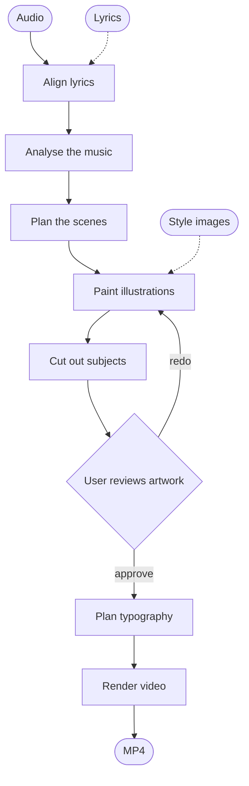
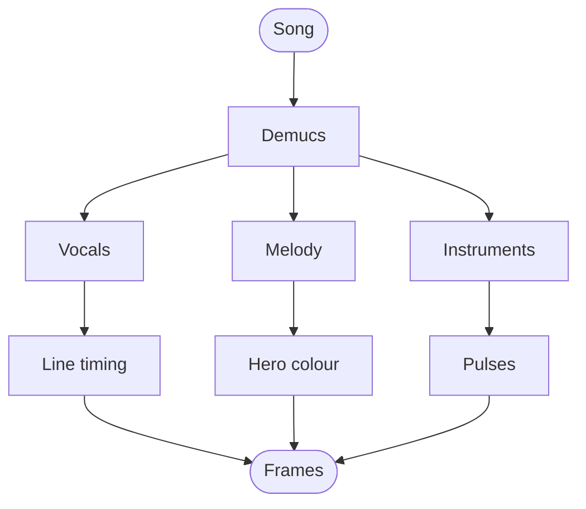

# Kinetic_Lyrics

Kinetic Lyrics turns a song (an MP3 or other audio file) into a lyric music video.

It lines the user's lyrics up with the singing, asks a local language model to plan
the typography and scenes, paints illustrations with a local image model, has a vision
model check the artwork, and then renders a kinetic-typography video with particle
transitions. Everything runs on the user's own machine, so a capable GPU is needed. The
aim is to reach the kind of rich, hand-crafted motion type that designers usually
build by hand in tools such as Adobe After Effects.

## How a video is made



If the user leaves the lyrics out, the first step transcribes them from the audio
instead. Timings, audio analysis and artwork are saved in the project folder, so a
rebuild after the user swaps an image reuses them instead of starting again from
scratch.

## Requirements

- Windows with an NVIDIA CUDA GPU. 24 GB of VRAM is recommended.
- Python 3.12.
- FFmpeg on the `PATH`. NVENC hardware encoding is used when it is available.
- [Ollama](https://ollama.com) with a text model, plus a vision model for reviewing
  the artwork.

## Setup

The user runs the setup script once from the project folder:

```powershell
powershell -ExecutionPolicy Bypass -File setup.ps1
```

The script creates a `.venv` folder, installs the CUDA build of PyTorch, and then
installs everything listed in `requirements.txt`. Model weights are not downloaded
during setup. They download the first time each model is used, and they are stored
in Ollama's model folder: the one named by `OLLAMA_MODELS`, or `~/.ollama/models`
if that variable is not set. To keep them somewhere else, the user can set
`KINETIC_LYRICS_MODEL_CACHE` to that folder. To choose where projects are written,
the user can set `KINETIC_LYRICS_OUTPUT`.

## Hugging Face

The image and speech models come from [Hugging Face](https://huggingface.co). The
default models are public, so no account is needed to get started. A few of the
optional image models are **gated**, which means the user has to accept their terms
on the model page and give the app an access token before they will download.

| Model | Used for | Access |
|---|---|---|
| `Qwen/Qwen-Image-2512` (default) | Illustrations | Public |
| `black-forest-labs/FLUX.2-klein-4B` | Illustrations | Public |
| `Tongyi-MAI/Z-Image-Turbo` | Illustrations | Public |
| [`black-forest-labs/FLUX.2-klein-9B`](https://huggingface.co/black-forest-labs/FLUX.2-klein-9B) | Illustrations | **Gated**, non-commercial licence |
| [`black-forest-labs/FLUX.1-schnell`](https://huggingface.co/black-forest-labs/FLUX.1-schnell) | Illustrations | **Gated** |
| [`black-forest-labs/FLUX.2-dev`](https://huggingface.co/black-forest-labs/FLUX.2-dev) | Illustrations | **Gated**, non-commercial licence |
| `Qwen/Qwen3-ASR-1.7B-hf`, `Qwen/Qwen3-ASR-0.6B-hf` | Transcription | Public |
| `Qwen/Qwen3-ForcedAligner-0.6B-hf` | Word timing | Public |
| `nvidia/parakeet-tdt-0.6b-v3` | Transcription | Public |
| Whisper large-v3 / turbo | Transcription and word timing | Public |

To use a gated model, the user:

1. Signs in at huggingface.co, opens the model page linked above and accepts the
   terms. Access is granted straight away.
2. Creates a token with **Read** access at https://huggingface.co/settings/tokens.
3. Saves the token in the `HF_TOKEN` user environment variable, then opens a new
   terminal so that it is picked up:

   ```powershell
   [Environment]::SetEnvironmentVariable('HF_TOKEN', 'hf_...', 'User')
   ```

The token must be set through `HF_TOKEN` rather than `hf auth login`. The app points `HF_HOME` at the
model folder, so it cannot see a token that `hf auth login` saved in its default
location. If a gated model fails with an "Access required" message, check that its
terms were accepted with the same account that owns the token.

## Project layout

- `src/` holds the Python code: the command line, the Studio server, the renderer
  and the model workers.
- `ui/` holds the Studio web front end (HTML, CSS and JavaScript).
- `tests/` holds the test suite, which runs with
  `python -m unittest discover -s tests`.
- `assets/`, `particles/` and `shaders/` hold images, effect recipes and GLSL shaders.

## Studio

Studio is the easiest way to make a video. Start it with:

```powershell
kinetic-studio.cmd
```

This opens a web page on the user's own computer at http://127.0.0.1:8765. The user
uploads the audio and pastes the lyrics, or leaves the lyrics blank so that Studio
transcribes them, and then picks the style references, models and effects. Before the
video renders, the user reviews each illustration and can replace or regenerate any
that do not fit. After a video is finished, the user can swap a single image and
rebuild only the parts that changed, and earlier exports remain available.

### Timeline editor

If some words come out of sync, the user can fix them in Studio's **Timeline editor**, which
appears once a video is finished. It shows the illustrations, the lyric lines and each word
above the waveforms of the full mix and of the separated vocals, drums, bass and other
instruments, so the user can see where each word is really sung. The colour of each waveform
can be changed, and any of them can be played on its own.

- Drag a word to move it, or drag its edges to change when it starts and ends. Drag a line to
  move all its words together. Holding Shift moves everything after it as well, which fixes a
  song that drifts out of sync from one point onwards.
- Drag an illustration to change when it appears.
- Double-click a word or a line to correct its text. Each line keeps the same number of words.
- Press T while the song plays to set the selected word to start at the playhead.

**Save & rebuild video** writes the new timing and renders the video again. The edits are kept
in `video.timings.json`, `lyrics.txt` and `video.art-times.json` in the project folder.

## Command line

A video can also be made without opening Studio:

```powershell
kinetic-lyrics.cmd song.mp3 lyrics.txt --theme "bright, uplifting" -o output\song.mp4
```

Some useful options:

- `--style-reference a.png b.png` gives the image model pictures to match the style of.
- `--illustrations art.png ...` uses the user's own artwork, and `--no-illustrations`
  makes a typography-only video.
- `--illustration-lines N` sets how many lyric lines share each illustration.
- `--artwork-mode cutout|fullscreen|verse|matte` chooses the artwork layout. `matte`
  is greenscreen scenery (see below).
- `--language tl` sets the lyric language.
- `--encoder libx264` and `--render-workers N` control encoding and how many CPU
  workers render frames.
- `--reading-flow realtime|preview` chooses how words appear (see below).
- `--kinetic '{...}'` and `--effect-speeds '{"glass-shatter": 0.5}'` fine-tune the
  motion and set the speed of individual effects.

Run `kinetic-lyrics.cmd --help` to see every option.

## Greenscreen scenery

The `matte` artwork mode ("Greenscreen scenery with lyrics in the sky" in Studio) builds
each scene from two generated images instead of one:

1. A scenery painting with a horizon or skyline (hills, water, rooftops, trees) and no
   main character. Everything above the skyline is painted flat chroma-key green.
2. A plain painting of the sky that belongs above that scenery, with the same light and
   palette.

The green is keyed out into a matte, and the finished artwork is the plain sky seen
through the scenery. When the video renders, the plain sky goes down first, the kinetic
typography is drawn on it, and the keyed scenery is laid over both. The lyrics can only
be seen where the green was, so a word that runs past the skyline disappears behind the
land. Lines are placed inside the open sky, and while two scenes blend the scenery of
both covers the lyrics. With a panning camera the camera travels along the horizon.

If a generated scenery has too little green sky, it is retried with a new seed and then
flagged for review. The matte is stored inside the artwork PNG, so selecting, archiving
or repairing an image keeps it. A replacement image without a stored matte uses its own
transparency as the sky, or keys any chroma green it contains. With neither, the whole
replacement image is treated as the sky.

## Real-time kinetic flow

By default, each word appears at the moment it is sung.



Demucs splits the song into the voice and the instruments. The voice sets when each
line starts, the melody sets the colour and pace of hero words, and the instruments
drive the pulses and glows.

- **Panning or still camera.** By default, all the illustrations are stitched into
  one seamless collage, and the camera glides through it at a steady speed. Each line
  is written where the camera is heading. If the user picks the still camera instead, each
  line is framed in a shape, and it plays its exit animation when that space is needed
  again.
- **Fonts chosen by role.** Small function words are set in a typewriter face, content
  words are heavy, and the most important "hero" words are huge and condensed. Hero
  words can also form out of particles or materials.
- **Melody and instruments.** Demucs separates the vocals from the instruments. Each
  line starts exactly when the voice comes in, high notes make hero words glow hot,
  fast passages snap into place, and some lines pulse with their main instrument. The
  voice itself never drives these pulses.
- **Backdrops and traces.** Whole lines can scroll past as marquees, and words can
  echo or grow giant behind the text. Glowing underlines, a ribbon of translucent wavy
  bands that flows from one hero word to the next, soft shapes behind hero words, and
  words that glow in time with an instrument all add depth.
- **Readable colour.** The renderer measures the colours of each entrance effect and
  checks the backdrop behind each line, so the lettering never blends into the
  background. Material lettering, such as oak, maple, gold filigree, pearl lace and
  embroidery, always gets a black outline.
- **AI effect choice.** When the user turns this on, a local model picks each line's entrance
  effect. It chooses from a shortlist of effects that stay readable on that line's
  backdrop and suit its meaning and scene.

The user can adjust all of this in Studio's **Kinetic effects** panel and save the
settings as profiles, including a separate particle speed for each effect. For the
earlier style, where the whole line appears before it is sung, use
`--reading-flow preview`.

Videos are encoded and tagged as BT.709. Every frame depends only on its timestamp,
so a video rendered across several CPU workers is identical to one rendered on a
single core.

## Particle effects

The entrance and exit effects are small JSON recipes stored in `particles/`. The
[`particles/README.md`](particles/README.md) guide explains how they work and how to
add new ones.

## License

Kinetic Lyrics is released under the [MIT License](LICENSE). The AI models that it
downloads are not part of this repository and each one has its own license. Some of
them, such as FLUX.2-klein-9B and FLUX.2-dev, allow only non-commercial use, so the
user should check a model's terms on its Hugging Face page before using its output
commercially.
