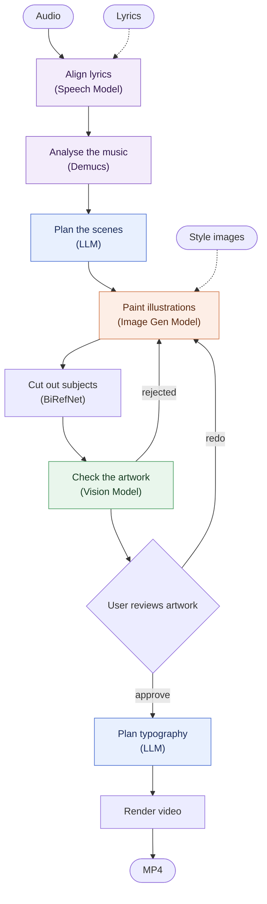
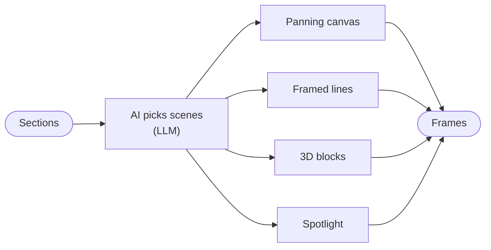

# Kinetic Lyrics

This is the public, local-model edition of Kinetic Lyrics.

Kinetic Lyrics turns a song (an MP3 or other audio file) into a lyric music video.

It lines the user's lyrics up with the singing, uses a local language model to plan
the typography and scenes, generates backgrounds using an image model, has a vision
model check the artwork, and then renders a kinetic-typography video with particle
transitions. Currently, all models were selected to run locally, on a consumer gaming
GPU. The aim is to reach the kind of rich, hand-crafted motion type that designers usually
build by hand in tools such as Adobe After Effects.

[](https://youtu.be/KnIPPDcqwNk)

This is a video made with Kinetic Lyrics on YouTube

## AI Pipeline



| Label | Model | Purpose |
|---|---|---|
| **Speech Model** | Qwen3-ASR, Parakeet or Whisper for transcription and word timing | Audio Transcription Model, Word Timing Model |
| **Demucs** | `htdemucs`, which splits the vocals from the instruments | Fixed |
| **LLM** | An Ollama text model that plans scenes, writes image prompts and directs the typography | Prompting and Revisions (Text Model) |
| **Image Gen Model** | Qwen Image 2.1, Qwen Image Edit 2511 or FLUX.2-klein, which all take reference pictures, for the illustrations and small typography pictures | Image Generation Model |
| **BiRefNet** | `birefnet-general`, which cuts subjects out of their backgrounds | Fixed |
| **Vision Model** | An Ollama vision model that scores each image for anatomy, limbs, facial hair on women and stray lettering, and rejects failures for repainting | Image Quality Scoring (VL Model) |

If no lyrics are supplied, Kinetic Lyrics will:
1. For YouTube videos, try known sources to retrieve the lyrics.
2. Otherwise, use an AI model to transcribe the lyrics from the audio.

An internal graphical tool lets the user fine-tune the timestamp of each word and save
the timings as JSON for later importing.


These steps run as a [LangGraph](https://langchain-ai.github.io/langgraph/) state graph
(`src/pipeline/graph.py`). After each step the graph saves its progress to
`<video>.graph.sqlite` in the project folder. If a run fails, starting it again with
`--resume` continues from its saved checkpoint. Studio uses this when resuming saved
work. When artwork review is enabled, the pipeline pauses for approval before rendering;
Studio can also automatically accept artwork when its automatic-accept option is enabled.

## Repository layout

- `src/`: Python packages and the Studio front end.
- `assets/`: bundled fonts, reference images, particle recipes (`particles/`),
  scene recipes (`scenes/`), and GPU shaders (`shaders/`).
- `tests/`: automated checks and render baselines.
- `automation/`: effect-development tools and records.

Bundled asset paths resolve through `core.paths.ASSET_ROOT`, independently of the
working directory. Bundled reference pictures are `assets/reference_female_1.jpeg`
(character reference) and `assets/reference_female_2.jpeg` (art-style reference).

Studio uses `KINETIC_LYRICS_OUTPUT` first, then the folder saved in Settings, then an
existing local `output/lyric-studio` folder, or `Documents/Kinetic Lyrics` for a new
installation. Command-line exports use `--output`.

## Requirements

- Windows with an NVIDIA CUDA GPU. 24 GB of VRAM is recommended.
- Python 3.12.
- FFmpeg on the `PATH`. NVENC hardware encoding is used when it is available.
- [Ollama](https://ollama.com) with a text model, plus a vision model for reviewing
  the artwork.

## Setup

Run the following setup script once from the project folder:

```powershell
powershell -ExecutionPolicy Bypass -File setup.ps1
```

This script does the following:
1. Creates a `.venv` folder.
2. Installs the CUDA build of PyTorch.
3. Installs everything listed in `requirements.txt` and verifies CUDA is available.

Important environment variables:
1. `KINETIC_LYRICS_MODEL_CACHE`: Default cache root for downloaded local models.
2. `OLLAMA_MODELS`: Used as the cache root when the variable above is unset;
   otherwise the default is `~/.ollama/models`. Studio's model-folder setting and
   the CLI's `--image-cache` can choose another location.
3. `KINETIC_LYRICS_OUTPUT`: Overrides Studio's project folder.
4. `HF_TOKEN`: Allows Kinetic Lyrics to access Hugging Face models, see https://huggingface.co/docs/huggingface_hub/en/package_reference/environment_variables

## Local models and downloads

Local image and speech weights download on first use. The image choices below match
the bundled model catalogue. Storage figures are catalogue estimates in GB, not
exact download sizes or VRAM requirements; allow extra room for caches and generated files.

| Image model | Use | Estimated model storage |
|---|---|---|
| `Qwen/Qwen-Image-2.1` (default) | Generation and editing with up to 4 references; Q4_K_M transformer | 26 GB |
| `Qwen/Qwen-Image-Edit-2511` | Editing and reference-guided illustration; up to 3 references | 62 GB |
| `black-forest-labs/FLUX.2-klein-4B` | Fast illustration with reference images | 22 GB |
| `black-forest-labs/FLUX.2-klein-9B` | Larger reference-guided model with 4-bit loading | 40 GB |

The default Qwen 2.1 loader uses the quantized transformer from
[`abenzerps/Qwen-Image-2.1-Uncensored-Quantized`](https://huggingface.co/abenzerps/Qwen-Image-2.1-Uncensored-Quantized),
with the other components from Qwen's repository. Components quantized to NF4 are
cached under `quantized-nf4` inside the selected model cache.

Studio offers Qwen3-ASR 1.7B or 0.6B, Parakeet TDT 0.6B v3, and Whisper Large v3 or
Turbo for transcription. Word timing can use Auto, Qwen3 ForcedAligner, or Whisper;
language support differs between models. The first Qwen/Parakeet run prepares a
separate speech environment under `.runtime/asr`. The command line retains its
legacy Whisper default unless an ASR preset is supplied.

Some [Hugging Face](https://huggingface.co) repositories require an account, acceptance
of their terms, and `HF_TOKEN`. Model licence information is shown in Studio; review
the selected model's terms before using its output commercially.

## User Interface

Kinetic Studio is the browser interface. From the repository folder, run:

```powershell
.\kinetic-studio.cmd
```

It opens http://127.0.0.1:8765. Use `--port 8766` to run a second instance with a
separate output folder.

### Reference editing

Use the **↻** button on a recurring reference to edit its saved description and
generation prompt. The panel shows the current image and lets you attach other
recurring references, project pictures, built-in art-style references, or uploaded
inputs. Each picture can guide identity, style, or specific details.

**Save and regenerate** stores the recipe in the project, removes superseded
artwork from active use, rebuilds derived references, and regenerates dependent
illustrations. The old output remains in a recovery archive. **Edit** retains the
separate in-image editor and its prewritten "Do not change anything else…" prompt.

Clicking a history thumbnail previews it. **Use as reference** selects that version
and rebuilds dependent artwork. **Discard** on the current version restores the
previous reference; discarding another version leaves the current selection alone.

### Image Maker

Image Maker generates standalone pictures and edits attached reference images.
It saves prompts, queued requests and result history. Qwen Image 2.1 supports
numbered region guides; **Keep everything outside selected regions unchanged**
requires PNG and preserves the source dimensions and pixels outside the selections.

### Pipeline history

Each stage in the pipeline graph has a version dropdown. Choosing an earlier
version selects the newest saved versions of later stages that used those exact
upstream versions. A stage with no compatible output shows **Needs regeneration**.
Versions made from different inputs remain in the list, disabled until their
upstream versions are selected. Stop running work and clear queued actions before
switching versions.

The **Pipeline** dropdown restores an entire saved selection. These are two
separate version numbers: pipeline v7 might select timing v2, prompts v4, and
images v3. Every change saves a new selection; older selections remain available.
For an existing project, **Save current pipeline** imports its current outputs.
Old outputs already removed before history was enabled cannot be recovered.

The project's `pipeline.json` stores the active selection, the history of complete
node-version selections, and each node version's upstream dependencies. Immutable
node manifests live in `pipeline/<node>/v<number>/manifest.json`. File contents
are stored once under `pipeline/objects/<sha256>` and shared across versions.
The existing project files are the working copy used by Studio and the renderer.
Completed stage outputs are archived automatically; incomplete work is never
published as a completed version. Switching versions restores saved outputs and
their stage settings without running the AI models. A restore journal lets Studio
recover the previous working copy if a restore is interrupted.
Unfinished or manually edited working files are retained in
`pipeline/working-copies/` before a switch; their manifests are listed in
`pipeline.json`. They are kept separately from completed node versions.

## Command line

A video can also be made without opening Studio:

```powershell
.\kinetic-lyrics.cmd song.mp3 lyrics.txt --theme "bright, uplifting" -o output\song.mp4
```

Some useful options:

- `--style-reference a.png b.png` gives the image model pictures to match the style of.
- `--illustrations art.png ...` uses the user's own artwork, and `--no-illustrations`
  makes a typography-only video.
- `--illustration-lines N` sets how many lyric lines share each illustration;
  `--illustration-lines auto` asks the local text model after alignment.
- `--artwork-mode cutout|fullscreen|verse|matte` chooses the artwork layout. `matte`
  is greenscreen scenery (see below).
- `--audio-mode karaoke` exports the instrumental mix while retaining the original
  audio for timing and stem analysis.
- `--language tl` sets the lyric language.
- `--encoder libx264` and `--render-workers N` control encoding and how many CPU
  workers render frames.
- `--reading-flow` chooses how words appear: `realtime` (the default) lands each word as it is
  sung, `preview` shows the whole line before the vocal, `stage` groups lines into blocks in a 3D
  world, `cinema` shows one short phrase at a time over the artwork (spotlight), and `mixed`
  gives each song section its own scene effect (see Scene mix below).
- `--kinetic '{...}'` and `--effect-speeds '{"glass-shatter": 0.5}'` fine-tune the
  motion and set the speed of individual effects.
- `--resume` continues an interrupted run from its last completed step.

Run `.\kinetic-lyrics.cmd --help` to see every option.

## Greenscreen scenery

The `matte` artwork layout ("Greenscreen scenery with lyrics in the sky" in Studio) builds
each scene from two generated images: a scenery painting with a horizon or skyline and no
main character, painted flat chroma-key green above the skyline, and a plain painting of
the sky that belongs above it. The green is keyed out into a matte. When the video
renders, the sky goes down first, the kinetic typography is drawn on it, and the keyed
scenery is laid over both, so a word that runs past the skyline disappears behind the
land. If a scenery has too little green sky, it is retried with a new seed and then
flagged for review.

## Appearance

Choose a still backdrop and panel colours in Settings → Appearance.

## Scene mix

With the scene mix reading flow (`--reading-flow mixed`), the video changes its look
with the song. Each verse, chorus and bridge is filmed in one scene effect, and long
sections are split at their longest pauses. A local model picks the scene for each
section from the ones the user ticked, matching it to what the section says. A
repeated chorus always keeps the same scene, and the choices are saved in
`video.scenes.json`. Where the scene changes, the old picture pushes in and fades as
the new one settles, just before the first word of the new section.



Scene effects are small JSON recipes in `assets/scenes/`, like the particle recipes. The
file name is the scene's ID, and `camera` picks how the scene is filmed:

| Field | What it controls |
|---|---|
| `name`, `description` | What Studio shows, and what the model reads when it picks scenes |
| `camera` | `pan` for the panning canvas, `still` for framed lines, `blocks` for the 3D stage, or `cinema` for spotlight |
| `particles` | For a `blocks` scene, preferred particle effects. The AI may choose any selected entrance except in **Tree canopy**, where it is limited to maple, oak and bamboo. Pan, still and cinema scenes keep the per-line entrance effects, so this is `null` for them |
| `layout` | Optional, and only for a `blocks` scene. `justified` (the default) gives rows of equal width. `contrast`, used by **Sweet contrast**, mixes thin and heavy words, gives every letter of one heavy word its own moving texture (marble, warped stripes, ripples, a rolling sweep or glinting grain) in tones close to the accent, and runs the last word vertically, close beside the rows. Every letter springs in with an elastic bounce, and the camera zooms in and rolls into a tilt. The side, the reading direction of the vertical word, the font pairing, the tilt and the zoom vary from block to block |

The panning canvas and framed lines keep all their effects, including the flowing
bands, the drifting shapes, the highlighting and the backdrops.

## Development

To copy a saved Studio session from another checkout, run this from the destination:

```powershell
.venv\Scripts\python.exe automation\copy_session.py D:\path\to\source-checkout
```

The argument can also be the source sessions folder. Type its number and press Enter,
or press Escape to cancel. The copy replaces a matching session, retaining the previous
copy under `.session-backups`. Internal paths, checkpoints and pipeline history are
relocated. Stop active work before copying, then restart the destination Studio.
Use `--destination PATH` to choose a different output folder; the tool remembers it
in this checkout's Studio settings. Without an existing setting, it uses
`output/lyric-studio` inside this checkout.

Install the test and lint tools once, then run the tests and the lint checks from the project folder:

```powershell
.venv\Scripts\python.exe -m pip install -r requirements-dev.txt
.venv\Scripts\python.exe -m pytest
.venv\Scripts\python.exe -m ruff check src tests
```

`ruff.toml` runs ruff's correctness checks (undefined names, unused imports) over everything. Format new
and changed files with `python -m ruff format <file>`; older files keep their style until they are edited.

## Licence

AGPL-3.0. For a commercial licence, contact jon.castillo.dev@gmail.com.

The AI models have their own licences, separate from this application's licence.
Check the selected model's terms on its model page before using its output commercially.

The fonts in `assets/fonts/` are bundled stand-ins for Windows fonts and keep their own
open licences (SIL OFL and the DejaVu licence), which sit beside each font file.
