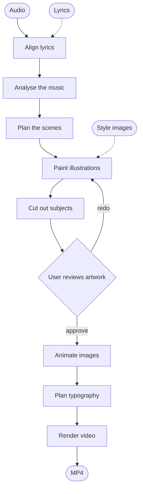
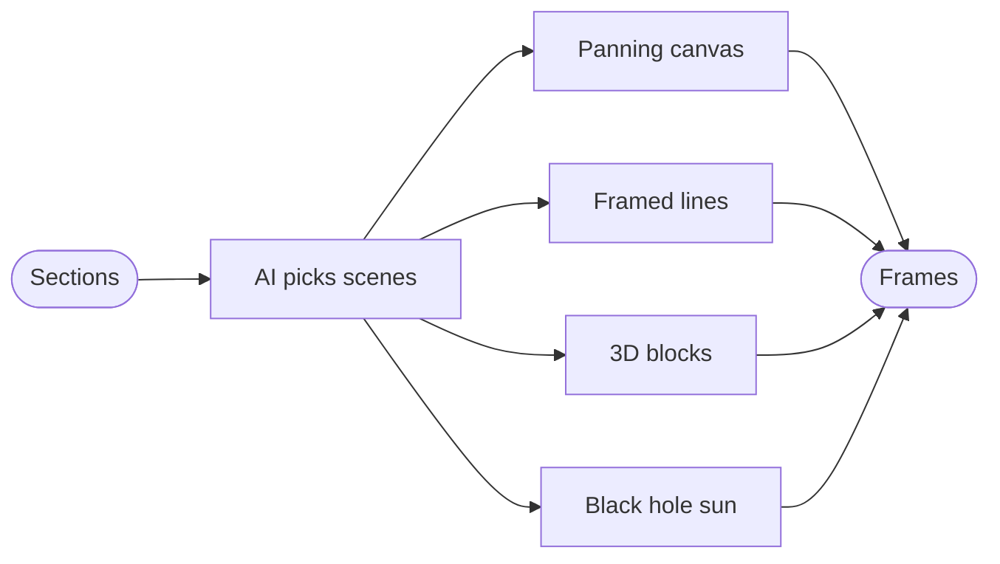
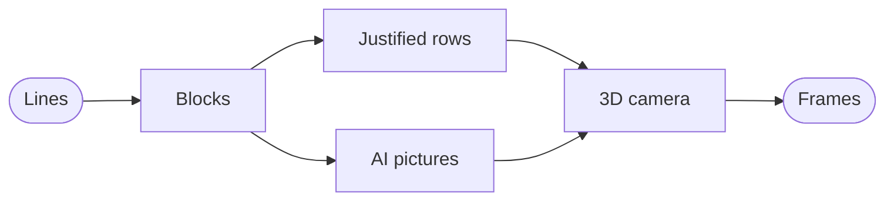

# Kinetic_Lyrics

Kinetic Lyrics turns a song (an MP3 or other audio file) into a lyric music video.

It lines the user's lyrics up with the singing, asks a local language model to plan
the typography and scenes, paints illustrations with a local image model, has a vision
model check the artwork, and then renders a kinetic-typography video with particle
transitions. Everything runs on the user's own machine, so a capable GPU is needed. The
aim is to reach the kind of rich, hand-crafted motion type that designers usually
build by hand in tools such as Adobe After Effects.

## How a video is made



If the user leaves the lyrics out, the first step transcribes them from the audio
instead. Timings, audio analysis and artwork are saved in the project folder, so a
rebuild after the user swaps an image reuses them instead of starting again from
scratch.

These steps run as a [LangGraph](https://langchain-ai.github.io/langgraph/) state graph
(`src/pipeline/graph.py`). After each step the graph saves its progress to
`<video>.graph.sqlite` in the project folder. If a run fails, starting it again with
`--resume` continues from the step that failed. Studio does this automatically when it
recovers a failed job. The artwork review is a pause in the graph: the run waits there
until the user approves the illustrations, and then carries on.

## Requirements

- Windows with an NVIDIA CUDA GPU. 24 GB of VRAM is recommended.
- Python 3.12.
- FFmpeg on the `PATH`. NVENC hardware encoding is used when it is available.
- [Ollama](https://ollama.com) with a text model, plus a vision model for reviewing
  the artwork.

## Setup

The user runs the setup script once from the project folder:

```powershell
powershell -ExecutionPolicy Bypass -File setup.ps1
```

The script creates a `.venv` folder, installs the CUDA build of PyTorch, and then
installs everything listed in `requirements.txt`. Model weights are not downloaded
during setup. They download the first time each model is used, and they are stored
in Ollama's model folder: the one named by `OLLAMA_MODELS`, or `~/.ollama/models`
if that variable is not set. To keep them somewhere else, the user can set
`KINETIC_LYRICS_MODEL_CACHE` to that folder. To choose where projects are written,
the user can set `KINETIC_LYRICS_OUTPUT`.

## Hugging Face

The image and speech models come from [Hugging Face](https://huggingface.co). The
default models are public, so no account is needed to get started. A few of the
optional image models are **gated**, which means the user has to accept their terms
on the model page and give the app an access token before they will download.

| Model | Used for | Access |
|---|---|---|
| `Qwen/Qwen-Image-2512` (default) | Illustrations | Public |
| `black-forest-labs/FLUX.2-klein-4B` | Illustrations | Public |
| `Tongyi-MAI/Z-Image-Turbo` | Illustrations | Public |
| [`black-forest-labs/FLUX.2-klein-9B`](https://huggingface.co/black-forest-labs/FLUX.2-klein-9B) | Illustrations | **Gated**, non-commercial licence |
| [`black-forest-labs/FLUX.1-schnell`](https://huggingface.co/black-forest-labs/FLUX.1-schnell) | Illustrations | **Gated** |
| [`black-forest-labs/FLUX.2-dev`](https://huggingface.co/black-forest-labs/FLUX.2-dev) | Illustrations | **Gated**, non-commercial licence |
| `Qwen/Qwen3-ASR-1.7B-hf`, `Qwen/Qwen3-ASR-0.6B-hf` | Transcription | Public |
| `Qwen/Qwen3-ForcedAligner-0.6B-hf` | Word timing | Public |
| `nvidia/parakeet-tdt-0.6b-v3` | Transcription | Public |
| Whisper large-v3 / turbo | Transcription and word timing | Public |

To use a gated model, the user:

1. Signs in at huggingface.co, opens the model page linked above and accepts the
   terms. Access is granted straight away.
2. Creates a token with **Read** access at https://huggingface.co/settings/tokens.
3. Saves the token in the `HF_TOKEN` user environment variable, then opens a new
   terminal so that it is picked up:

   ```powershell
   [Environment]::SetEnvironmentVariable('HF_TOKEN', 'hf_...', 'User')
   ```

The token must be set through `HF_TOKEN` rather than `hf auth login`. The app points `HF_HOME` at the
model folder, so it cannot see a token that `hf auth login` saved in its default
location. If a gated model fails with an "Access required" message, check that its
terms were accepted with the same account that owns the token.

## Project layout

All code lives in `src/`, one folder per area. Each AI model family has its own folder
under `src/models/`, so the code that loads and calls a model is kept apart from the code
that decides what to ask it.

```
src/
  pipeline/      Command line (pipeline/cli.py), the LangGraph graph and its steps
  models/        One folder per AI model family:
    ollama/        Local text language models: Ollama service, GPU admission, catalog, traces
    vision/        Vision-model review of artwork, and the score policy
    image/         Diffusion image models: catalog, pipeline loading, Qwen precision
    speech/        Whisper, Qwen3-ASR, Qwen3 aligner and Parakeet
    separation/    Demucs vocal and instrument stems
    matting/       BiRefNet background removal
    ocr/           RapidOCR lettering and frame checks
    gpu/           GPU detection, VRAM accounting, presets and model sessions
    downloads.py   Background downloads for every model family
  direction/     What the language model is asked to plan: scenes, image prompts,
                 typography, effects, song structure
  audio/         Melody, vocal onsets and instrument rhythm from the separated stems
  artwork/       Illustration files: generation jobs, gallery, review state, queues,
                 greenscreen mattes
  render/        Frame compositor, layouts, real-time typography, camera canvas, encoding
  effects/       Lettering effects: particles/ and growth/
  video_generation/  Optional video step: LTX-2.5 and MiniMax H3 image-to-video models,
                 saved clips and looping playback (see its README.md)
  studio/        Studio web server, background worker, batches and exports
  core/          Paths, progress events, subprocess and text helpers
  frontend/      Studio web front end (HTML, CSS and JavaScript)
```

- `tests/` holds the test suite, which runs with `python -m unittest discover -s tests`.
- `assets/`, `particles/` and `shaders/` hold images, effect recipes and GLSL shaders.
- `assets/fonts/` holds openly licensed fonts, each with its licence file. The renderer asks for
  Windows fonts such as Impact, Segoe UI Black and Georgia by name; on a machine without one,
  `src/core/fonts.py` uses a bundled stand-in of the same weight (Anton, Archivo Black, Alfa Slab
  One or DejaVu), so videos and tests render the same way on Linux and macOS.

The packages are imported with `src/` on `PYTHONPATH`. The `.cmd` launchers set this and
run `python -P -m pipeline.cli` (command line) or `python -P -m studio.server` (Studio).

## Studio

Studio is the easiest way to make a video. Start it with:

```powershell
kinetic-studio.cmd
```

This opens a web page on the user's own computer at http://127.0.0.1:8765. The user
uploads the audio and pastes the lyrics, or leaves the lyrics blank so that Studio
transcribes them, and then picks the style references, models and effects. A YouTube
video link can also be imported: Studio downloads its audio,
checks LRCLIB, Genius and lyrics.ovh for matching text, and asks the local text model
to rank the lyric candidates. If none match, the usual transcription step runs.
The **Lines per image** field accepts `auto`; the text model then chooses a grouping
after the lyrics are timed. **Karaoke instrumental** exports the drum, bass and other
stems without the lead vocal.

Before the video renders, the user reviews each illustration and can replace or regenerate any
that do not fit. After a video is finished, the user can swap a single image and
rebuild only the parts that changed, and earlier exports remain available.

### Timeline editor

If some words come out of sync, the user can fix them in Studio's **Timeline editor**, which
appears once a video is finished. It shows the illustrations, the lyric lines and each word
above the waveforms of the full mix and of the separated vocals, drums, bass and other
instruments, so the user can see where each word is really sung. The colour of each waveform
can be changed, and any of them can be played on its own.

- Drag a word to move it, or drag its edges to change when it starts and ends. Drag a line to
  move all its words together. Holding Shift moves everything after it as well, which fixes a
  song that drifts out of sync from one point onwards.
- Drag an illustration to change when it appears.
- Double-click a word or a line to correct its text. Each line keeps the same number of words.
- Press T while the song plays to set the selected word to start at the playhead.

**Save & rebuild video** writes the new timing and renders the video again. The edits are kept
in `video.timings.json`, `lyrics.txt` and `video.art-times.json` in the project folder.

## Command line

A video can also be made without opening Studio:

```powershell
kinetic-lyrics.cmd song.mp3 lyrics.txt --theme "bright, uplifting" -o output\song.mp4
```

Some useful options:

- `--style-reference a.png b.png` gives the image model pictures to match the style of.
- `--illustrations art.png ...` uses the user's own artwork, and `--no-illustrations`
  makes a typography-only video.
- `--illustration-lines N` sets how many lyric lines share each illustration;
  `--illustration-lines auto` asks the local text model after alignment.
- `--artwork-mode cutout|fullscreen|verse|matte` chooses the artwork layout. `matte`
  is greenscreen scenery (see below).
- `--audio-mode karaoke` exports the instrumental mix while retaining the original
  audio for timing and stem analysis.
- `--language tl` sets the lyric language.
- `--encoder libx264` and `--render-workers N` control encoding and how many CPU
  workers render frames.
- `--reading-flow realtime|preview` chooses how words appear (see below).
- `--kinetic '{...}'` and `--effect-speeds '{"glass-shatter": 0.5}'` fine-tune the
  motion and set the speed of individual effects.
- `--resume` continues an interrupted run from its last completed step.

Run `kinetic-lyrics.cmd --help` to see every option.

## Greenscreen scenery

The `matte` artwork mode ("Greenscreen scenery with lyrics in the sky" in Studio) builds
each scene from two generated images instead of one:

1. A scenery painting with a horizon or skyline (hills, water, rooftops, trees) and no
   main character. Everything above the skyline is painted flat chroma-key green.
2. A plain painting of the sky that belongs above that scenery, with the same light and
   palette.

The green is keyed out into a matte, and the finished artwork is the plain sky seen
through the scenery. When the video renders, the plain sky goes down first, the kinetic
typography is drawn on it, and the keyed scenery is laid over both. The lyrics can only
be seen where the green was, so a word that runs past the skyline disappears behind the
land. Lines are placed inside the open sky, and while two scenes blend the scenery of
both covers the lyrics. With a panning camera the camera travels along the horizon.

If a generated scenery has too little green sky, it is retried with a new seed and then
flagged for review. The matte is stored inside the artwork PNG, so selecting, archiving
or repairing an image keeps it. A replacement image without a stored matte uses its own
transparency as the sky, or keys any chroma green it contains. With neither, the whole
replacement image is treated as the sky.

## Video generation

The video step is optional and off by default. When it is on, every approved
illustration is turned into a short clip by a local image-to-video model, and the clip
plays behind the lyrics in place of the still image. In Studio, tick "Animate each image
with a video model" under the artwork layout and choose LTX-2.5 or MiniMax H3. On the
command line, pass `--video-model Lightricks/LTX-2.5-Diffusers` or
`--video-model MiniMaxAI/MiniMax-H3`. It works with the `fullscreen` and `verse` artwork
modes only. The models need their own Python environment, which
`src/video_generation/setup.ps1` creates. Setup, model details, licences and timing are
described in [src/video_generation/README.md](src/video_generation/README.md).

## Real-time kinetic flow

By default, each word appears at the moment it is sung.


Demucs splits the song into the voice and the instruments. The voice sets when each
line starts, the melody sets the colour and pace of hero words, and the instruments
drive the pulses and glows.

- **Panning or still camera.** By default, all the illustrations are stitched into
  one seamless collage, and the camera glides through it at a steady speed. Each line
  is written where the camera is heading. If the user picks the still camera instead, each
  line is framed in a shape, and it plays its exit animation when that space is needed
  again.
- **Fonts chosen by role.** Small function words are set in a typewriter face, content
  words are heavy, and the most important "hero" words are huge and condensed. Hero
  words can also form out of particles or materials.
- **Melody and instruments.** Demucs separates the vocals from the instruments. Each
  line starts exactly when the voice comes in, high notes make hero words glow hot,
  fast passages snap into place, and some lines pulse with their main instrument. The
  voice itself never drives these pulses.
- **Backdrops and traces.** Whole lines can scroll past as marquees, and words can
  echo or grow giant behind the text. Glowing underlines, a ribbon of translucent wavy
  bands that flows from one hero word to the next, soft shapes behind hero words, and
  words that glow in time with an instrument all add depth.
- **Readable colour.** The renderer measures the colours of each entrance effect and
  checks the backdrop behind each line, so the lettering never blends into the
  background. Material lettering, such as oak, maple, gold filigree, pearl lace and
  embroidery, always gets a black outline.
- **AI effect choice.** When the user turns this on, a local model picks each line's entrance
  effect. It chooses from a shortlist of effects that stay readable on that line's
  backdrop and suit its meaning and scene.

The user can adjust all of this in Studio's **Kinetic effects** panel and save the
settings as profiles, including a separate particle speed for each effect. For the
earlier style, where the whole line appears before it is sung, use
`--reading-flow preview`.

Videos are encoded and tagged as BT.709. Every frame depends only on its timestamp,
so a video rendered across several CPU workers is identical to one rendered on a
single core.

## Scene mix

With the scene mix reading flow (`--reading-flow mixed`), the video changes its look
with the song. Each verse, chorus and bridge is filmed in one scene effect, and long
sections are split at their longest pauses. A local model picks the scene for each
section from the ones the user ticked, matching it to what the section says. A
repeated chorus always keeps the same scene, and the choices are saved in
`video.scenes.json`. Where the scene changes, the old picture pushes in and fades as
the new one settles, just before the first word of the new section.



Scene effects are small JSON recipes in `scenes/`, like the particle recipes. The
file name is the scene's ID, and `camera` picks how the scene is filmed:

| Field | What it controls |
|---|---|
| `name`, `description` | What Studio shows, and what the model reads when it picks scenes |
| `camera` | `pan` for the panning canvas, `still` for framed lines, `blocks` for the 3D stage, or `cinema` for black hole sun |
| `particles` | For a `blocks` scene, preferred particle effects. The AI may choose any selected entrance except in **Tree canopy**, where it is limited to maple, oak and bamboo. Pan, still and cinema scenes keep the per-line entrance effects, so this is `null` for them |
| `layout` | Optional, and only for a `blocks` scene. `justified` (the default) gives rows of equal width. `contrast`, used by **Sweet contrast**, mixes thin and heavy words, gives every letter of one heavy word its own moving texture (marble, warped stripes, ripples, a rolling sweep or glinting grain) in tones close to the accent, and runs the last word vertically, close beside the rows. Every letter springs in with an elastic bounce, and the camera zooms in and rolls into a tilt. The side, the reading direction of the vertical word, the font pairing, the tilt and the zoom vary from block to block |

The panning canvas and framed lines keep all their effects, including the flowing
bands, the drifting shapes, the highlighting and the backdrops.

## Black hole sun

Black hole sun is minimal cinematic typography in the style of short-form lyric edits. It is
used by the **Black hole sun** scene, and also on its own with `--reading-flow cinema`. Each
line is cut into chunks of one to three words at the sung timings, and only one chunk is on
screen at a time, centred over the artwork. Every chunk uses two weights of Montserrat (bundled
in `assets/fonts`, under the SIL Open Font License): a hairline, widely tracked word above or
below an ultra-black one, so "BLACK" sits thin over a heavy "HOLE". Words arrive as they are
sung. Hairline words settle in from oversized and faint, and heavy words slide in with motion
blur and brighten from grey. Some words flip in from their mirror image, and the odd lone word
stands on end. A chunk pushes in slowly while it holds, then flips, slides or blurs away just
before the next one arrives, and the artwork pushes in behind it. It looks best with
full-screen artwork (`--artwork-mode fullscreen`).

## 3D stage

The 3D stage groups the lines that are sung together into blocks and sets each block
as a rectangle of justified words. It is used by the 3D scene effects, and also on
its own with `--reading-flow stage`. Each row is scaled to fill the same width, so a
short row of big words can sit above a long row of small ones. Each block stands
somewhere in a 3D space. The camera never stops. It cruises across the current block
while it is sung, then speeds up along an arc to the next block and pulls back on
the way, so the earlier blocks, which stay where they were written, come back into
view. Behind everything lies one continuous collage of the illustrations, stitched
along the camera's path like the panning canvas and bent like a sheet of curved
paper. Its gentle folds are shaded and shift with parallax.



- **Top row effects.** Particle effects tagged as top only, such as the maple trees,
  grow only on a block's top row, so they never cover the words below. The other
  rows stay plain, with one accent word picked out in colour.
- **Matched choices.** For each block, a local model picks the entry motion, the
  accent colour (only from colours that stay readable on that background), which of
  selected entrance effects grows on the top row (tree effects only in Tree canopy), and the picture, so that
  they all suit each other and the lyric. The choices are saved in
  `video.blocks.json`.
- **Bands and shapes.** As in the panning canvas, translucent bands flow on from one
  block to the next, here through 3D space, and outlined shapes drift and turn on
  strong bass notes at different depths around the blocks. In both places the band
  bends continuously, like the waves on a PSP menu. It never turns a corner, brakes or
  stops: it weaves gentle S-curves where it has time to spare and cruises at one
  steady speed, easing only slightly faster or slower to stay near the words.
- **Moving words.** Words flip, swing, rise or drop into place as they are sung, hero
  words are extruded for depth, and some words keep moving with a letter wave, a beat
  pulse or a slow tilt.
- **Small animated pictures.** A local model reads each block's lyrics and decides
  whether it gets a small picture, which word carries it, what it shows and how it
  moves. A round picture can replace the word's letter O, so MOON can show a moon
  with clouds drifting across it. Any other picture takes its own slot in the word's
  row, so the words and pictures share one rectangle. The picture comes from the library when one fits,
  and otherwise the image model paints it as a transparent cutout. The library is
  made up of built-in drawings plus any animated GIF, WebP or PNG that the user puts
  in `assets/ornaments/`, named after its subject (for example `moon.webp`). Google's
  Noto Animated Emoji are a good free source, licensed CC BY 4.0. Painted pictures
  are asked for in the block's accent colour. The user picks AI pictures,
  library-only AI pictures, keyword pictures or no pictures with `--stage-pictures`
  or in Studio.

The stage is drawn on the GPU with ModernGL and renders at about 50 frames per second
on a single process at 720p.

## Particle effects

The entrance and exit effects are small JSON recipes stored in `particles/`. The
[`particles/README.md`](particles/README.md) guide explains how they work and how to
add new ones.

## License

Kinetic Lyrics is released under the [MIT License](LICENSE). The AI models that it
downloads are not part of this repository and each one has its own license. Some of
them, such as FLUX.2-klein-9B and FLUX.2-dev, allow only non-commercial use, so the
user should check a model's terms on its Hugging Face page before using its output
commercially.
