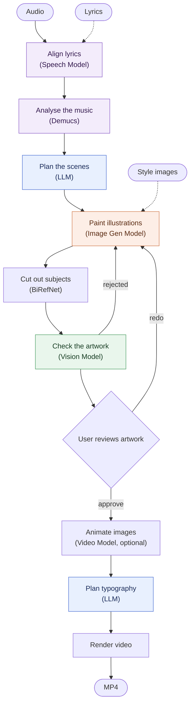
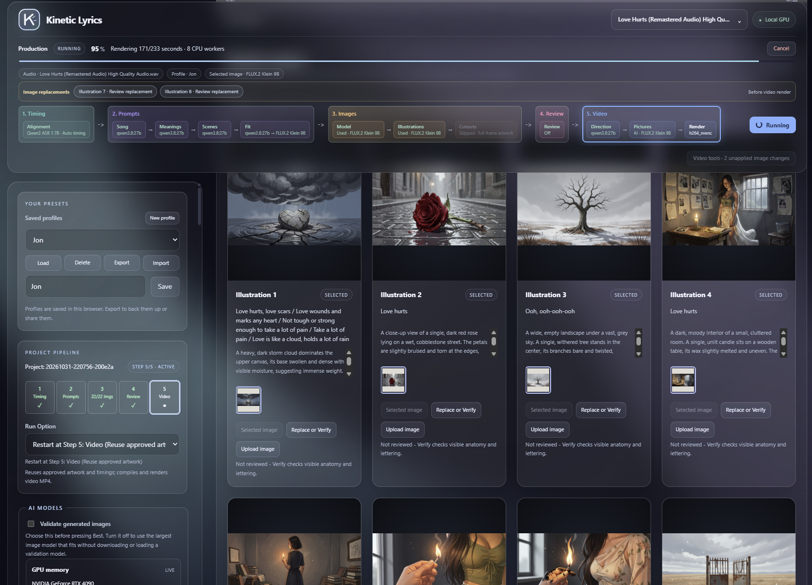
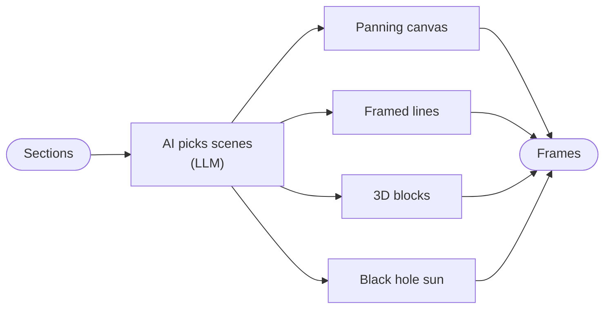

# Kinetic_Lyrics

Kinetic Lyrics turns a song (an MP3 or other audio file) into a lyric music video.

It lines the user's lyrics up with the singing, uses a local language model to plan
the typography and scenes, generates backgrounds using an image model, has a vision
model check the artwork, and then renders a kinetic-typography video with particle
transitions. Currently, all models were selected to run locally, on a consumer gaming
GPU. The aim is to reach the kind of rich, hand-crafted motion type that designers usually
build by hand in tools such as Adobe After Effects.

[](https://youtu.be/KnIPPDcqwNk)]

## AI Pipeline



| Label | Model | Purpose |
|---|---|---|
| **Speech Model** | Qwen3-ASR, Parakeet or Whisper for transcription and word timing | Audio Transcription Model, Word Timing Model |
| **Demucs** | `htdemucs`, which splits the vocals from the instruments | Fixed |
| **LLM** | An Ollama text model that plans scenes, writes image prompts and directs the typography | Prompting and Revisions (Text Model) |
| **Image Gen Model** | Qwen-Image (good for quality), FLUX.2-klein (allows a reference photo), Z-Image or FLUX.1 for the illustrations and small typography pictures | Image Generation Model |
| **BiRefNet** | `birefnet-general`, which cuts subjects out of their backgrounds | Fixed |
| **Vision Model** | An Ollama vision model that scores each image for anatomy, limbs, facial hair on women and stray lettering, and rejects failures for repainting | Image Quality Scoring (VL Model) |

If no lyrics are supplied, Kinetic Lyrics will attempt to 1. For Youtube Videos, 
try known sources to retrieve lyrics, or 2. Use an AI model to transcribe the
lyrics from the audio.

An internal graphical tool allows the user to fine-tune the timestamp for each word.
and saved as a JSON, for later importing.


These steps run as a [LangGraph](https://langchain-ai.github.io/langgraph/) state graph
(`src/pipeline/graph.py`). After each step the graph saves its progress to
`<video>.graph.sqlite` in the project folder. If a run fails, starting it again with
`--resume` continues from the step that failed. Studio does this automatically when it
recovers a failed job. The artwork review is a pause in the graph: the run waits there
until the user approves the illustrations, and then carries on.

## Requirements

- Windows with an NVIDIA CUDA GPU. 24 GB of VRAM is recommended.
- Python 3.12.
- FFmpeg on the `PATH`. NVENC hardware encoding is used when it is available.
- [Ollama](https://ollama.com) with a text model, plus a vision model for reviewing
  the artwork.

## Setup

Run the following setup script once from the project folder:

```powershell
powershell -ExecutionPolicy Bypass -File setup.ps1
```

This script does the following:
1. Creates a `.venv` folder.
2. Installs the CUDA build of PyTorch. 
3. Installs everything listed in `requirements.txt`. 

Important environment variables:
1. `OLLAMA_MODELS`: Model weights are downloaded during only during use, and they are stored in Ollama's model folder (defined by this variable).
If this environment variable isn't set, Ollama defaults the folder to `~/.ollama/models`
2. `KINETIC_LYRICS_MODEL_CACHE`: Allows the user to define a specific folder where Kinetic Lyrics AI models are saved, to separate them from Ollama's.
3. `KINETIC_LYRICS_OUTPUT`: Folder where Kinetic Lyrics projects are written.
4. `HF_TOKEN`: Allows Kinetic Lyrics to access Hugging Face models, see https://huggingface.co/docs/huggingface_hub/en/package_reference/environment_variables

## Hugging Face

The image and speech models come from [Hugging Face](https://huggingface.co). The default models are public, however, some are **gated**, which means the user has to accept their terms on the model page. This would require a Hugging Face account. Ensure that the `HF_TOKEN` environment is set, as mentioned above.

| Model | Used for | Access |
|---|---|---|
| `Qwen/Qwen-Image-2512` (default) | Illustrations. Good for quality: the most detailed images, but the slowest (50 steps) | Public |
| `black-forest-labs/FLUX.2-klein-4B` | Illustrations. Allows a reference photo, for example to cast a person as the main character | Public |
| `Tongyi-MAI/Z-Image-Turbo` | Illustrations | Public |
| [`black-forest-labs/FLUX.2-klein-9B`](https://huggingface.co/black-forest-labs/FLUX.2-klein-9B) | Illustrations. Allows a reference photo, with better detail than 4B | **Gated**, non-commercial licence |
| [`black-forest-labs/FLUX.1-schnell`](https://huggingface.co/black-forest-labs/FLUX.1-schnell) | Illustrations | **Gated** |
| [`black-forest-labs/FLUX.2-dev`](https://huggingface.co/black-forest-labs/FLUX.2-dev) | Illustrations | **Gated**, non-commercial licence |
| `Qwen/Qwen3-ASR-1.7B-hf`, `Qwen/Qwen3-ASR-0.6B-hf` | Transcription | Public |
| `Qwen/Qwen3-ForcedAligner-0.6B-hf` | Word timing | Public |
| `nvidia/parakeet-tdt-0.6b-v3` | Transcription | Public |
| Whisper large-v3 / turbo | Transcription and word timing | Public |

## User Interface

Kinetic Studio is Kinetic Lyrics' user interface. Start it with:

```powershell
kinetic-studio.cmd
```



This opens a web page on the user's own computer at http://127.0.0.1:8765. 

## Command line

A video can also be made without opening Studio:

```powershell
kinetic-lyrics.cmd song.mp3 lyrics.txt --theme "bright, uplifting" -o output\song.mp4
```

Some useful options:

- `--style-reference a.png b.png` gives the image model pictures to match the style of.
- `--illustrations art.png ...` uses the user's own artwork, and `--no-illustrations`
  makes a typography-only video.
- `--illustration-lines N` sets how many lyric lines share each illustration;
  `--illustration-lines auto` asks the local text model after alignment.
- `--artwork-mode cutout|fullscreen|verse|matte` chooses the artwork layout. `matte`
  is greenscreen scenery (see below).
- `--audio-mode karaoke` exports the instrumental mix while retaining the original
  audio for timing and stem analysis.
- `--language tl` sets the lyric language.
- `--encoder libx264` and `--render-workers N` control encoding and how many CPU
  workers render frames.
- `--reading-flow realtime|preview` chooses how words appear (see below).
- `--kinetic '{...}'` and `--effect-speeds '{"glass-shatter": 0.5}'` fine-tune the
  motion and set the speed of individual effects.
- `--resume` continues an interrupted run from its last completed step.

Run `kinetic-lyrics.cmd --help` to see every option.

## Greenscreen scenery

The `matte` artwork layout ("Greenscreen scenery with lyrics in the sky" in Studio) builds
each scene from two generated images: a scenery painting with a horizon or skyline and no
main character, painted flat chroma-key green above the skyline, and a plain painting of
the sky that belongs above it. The green is keyed out into a matte. When the video
renders, the sky goes down first, the kinetic typography is drawn on it, and the keyed
scenery is laid over both, so a word that runs past the skyline disappears behind the
land. If a scenery has too little green sky, it is retried with a new seed and then
flagged for review.

## Video generation

The video step is experimental, optional and off by default. When it is on, every
approved illustration is turned into a short clip by a local image-to-video model, and
the clip plays behind the lyrics in place of the still image. In Studio, tick "Animate
each image with a video model" in the **Experimental Features** box and choose LTX-2.5 or
MiniMax H3. On the command line, pass `--video-model Lightricks/LTX-2.5-Diffusers` or
`--video-model MiniMaxAI/MiniMax-H3`. It works with the `fullscreen` and `verse` artwork
layouts only. The models need their own Python environment, which
`src/video_generation/setup.ps1` creates; see
[src/video_generation/README.md](src/video_generation/README.md).

## Scene mix

With the scene mix reading flow (`--reading-flow mixed`), the video changes its look
with the song. Each verse, chorus and bridge is filmed in one scene effect, and long
sections are split at their longest pauses. A local model picks the scene for each
section from the ones the user ticked, matching it to what the section says. A
repeated chorus always keeps the same scene, and the choices are saved in
`video.scenes.json`. Where the scene changes, the old picture pushes in and fades as
the new one settles, just before the first word of the new section.



Scene effects are small JSON recipes in `scenes/`, like the particle recipes. The
file name is the scene's ID, and `camera` picks how the scene is filmed:

| Field | What it controls |
|---|---|
| `name`, `description` | What Studio shows, and what the model reads when it picks scenes |
| `camera` | `pan` for the panning canvas, `still` for framed lines, `blocks` for the 3D stage, or `cinema` for black hole sun |
| `particles` | For a `blocks` scene, preferred particle effects. The AI may choose any selected entrance except in **Tree canopy**, where it is limited to maple, oak and bamboo. Pan, still and cinema scenes keep the per-line entrance effects, so this is `null` for them |
| `layout` | Optional, and only for a `blocks` scene. `justified` (the default) gives rows of equal width. `contrast`, used by **Sweet contrast**, mixes thin and heavy words, gives every letter of one heavy word its own moving texture (marble, warped stripes, ripples, a rolling sweep or glinting grain) in tones close to the accent, and runs the last word vertically, close beside the rows. Every letter springs in with an elastic bounce, and the camera zooms in and rolls into a tilt. The side, the reading direction of the vertical word, the font pairing, the tilt and the zoom vary from block to block |

The panning canvas and framed lines keep all their effects, including the flowing
bands, the drifting shapes, the highlighting and the backdrops.

## Licence

AGPL-3.0. For a commercial licence, contact jon.castillo.dev@gmail.com.

The AI models that Kinetic Lyrics downloads have their own licences. Some of
them, such as FLUX.2-klein-9B and FLUX.2-dev, allow only non-commercial use.
Check a model's terms on its Hugging Face page before using its output
commercially.

The fonts in `assets/fonts/` are bundled stand-ins for Windows fonts and keep their own
open licences (SIL OFL and the DejaVu licence), which sit beside each font file.
