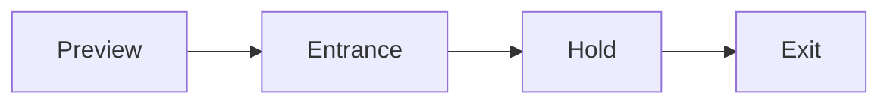
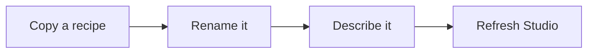

# Particle effects

Each entrance and exit effect is a small JSON recipe. The recipes in `entrance/`
control how a word arrives, and the recipes in `exit/` control how it leaves. Every
effect works on fragments of the real glyphs, so the particles are always shaped
like the word itself rather than laid on top of it.

## A word's lifetime



Upcoming words show as a faint preview at 8% opacity. A word's entrance begins at its sung
timestamp, the word then holds intact so it can be read, and its exit starts one
second after the word ends. Changing the motion speed makes the animation longer or
shorter, but the timing of the sung words stays the same. Setting the intensity to
zero turns the fragment effects off. A frame always depends only on its timestamp,
so seeking to a frame and rendering it again gives the same image.

## Choosing effects in Studio

The user picks one effect for each phase, or chooses **Mixed** and ticks several so
that each line uses a different one. **Browse entrances** and **Browse exits** open a
browser with search and family filters. Clicking an effect previews it, and **Use
this effect** selects it. If nothing is ticked, that phase uses plain type. The
user's choices are saved with profiles, jobs and rebuilds.

The previews use the same renderer and settings as the final video, and they run on
the CPU without loading any AI models.

When the user switches on AI selection, the language model only sees the effects the
user ticked. For each line it gets each effect's short description together with
that line's illustration and scene details. If a description or the scene changes,
the typography plan is made again at the next render.

## Adding an effect



The file name, without `.json`, becomes the effect's ID. No code changes or build
step are needed. Studio reloads the folders when the user refreshes it, and each
new render job scans them again. A render that is already running keeps the effects
it started with. If a recipe is invalid, it is skipped with a warning. If a saved
project uses an effect that has since been deleted, that phase falls back to plain
type and the user sees a warning.

Only recipes from certain families are used, in Studio and on the command line
alike. For entrances, these are the glass, letters, ornament, trees, cinematic and
material families, plus a few petal, ink and thread lettering effects. For exits, they
are the glass, petals, smoke, cinematic and material families. The other recipes on disk are kept so
that older projects still load, but choosing one of them gives plain type and a
warning. A new family is made available by adding it to the filter in
`discover_effects` in `src/particle_catalog.py`.

Here is `exit/glass-shatter.json`:

```json
{
  "name": "Glass shatter",
  "family": "glass",
  "trajectory": "radial",
  "spread": 1.65,
  "gravity": 0.85,
  "spin": 1.25,
  "twist": 0,
  "stagger": 0.1,
  "density": 1
}
```

| Field | What it controls |
|---|---|
| `family` | The material: glass, dust, sparks, ribbons, pixels, petals, snow, smoke, bubbles, ink, vortex, magnetic, letters, ornament, trees, flock, cinematic or material |
| `trajectory` | The direction of travel: radial, left, right, up, down, spiral, wave, fan or grow |
| `spread` | How far the fragments travel |
| `gravity` | How strongly fragments are pulled down. A negative value makes them rise |
| `spin`, `twist` | How much the fragments rotate and spiral |
| `stagger` | How spread out in time the fragments are released |
| `density` | How many fragments there are |
| `hold: "particles"` | Optional. The word stays made of particles at rest instead of turning back into solid type |
| `description` | Optional. Overrides the entry in `descriptions.json` |
| `placement: "top"` | Optional. Marks an effect that grows above the word, such as maple trees or gold filigree. The 3D stage uses it only on the top row of a block, where nothing sits above it. The default is `"any"` |

The allowed range of each number is defined in `src/particle_catalog.py`. New looks
can be built by combining these settings, but a brand-new material or simulation
needs code changes in `src/particle_motion.py`.

Every recipe should have a description in `descriptions.json` of no more than ten
words. Studio's search uses it, and so does AI selection.

## How some families behave

- **Glass** exits crack first and pause until a quarter of the exit has passed. Large
  shards then fly out, tumbling in three dimensions, and break again into smaller,
  faster pieces. This is a projection of rotating shards, not a ray-traced glass
  simulation.
- **Petal lettering** (`petals-wind-lettering`, `petals-breeze-lettering`,
  `petals-spiral-lettering`) sends many petals along curling paths into the shape of
  the word. The word stays made of petals while it holds, and its exit breaks up that
  petal word.
- **`letters-spin-*`** effects rotate strips of each glyph in three dimensions as
  they fly in.
- **Cinematic** effects, such as prismatic, liquid chrome and ember, add
  shaded streamers, droplets and trails. They fade in from invisible, and they leave
  along a different path from the one they arrived on.

- **Material** effects (Studio's *Real materials* filter) build the word out of, or
  dissolve it into, a physical substance. A sandstone block is worn away by centuries
  of wind under a time-lapse sun; gold is poured into letter moulds; Mucha-style satin
  billows in and drapes into the glyphs; paper burns behind a glowing ember edge.
  Each one is a painter in `src/material_recipes.py`, built from the shared pieces in
  `src/material_fx.py`: signed distances to the glyph, noise and Voronoi cells,
  height-field shading for stone, metal, satin, glass and ice, and particles whose
  paths are solved in closed form. Their JSON recipes only name them, so a new
  material needs a painter as well as a recipe. They run at an ink height of at most
  150 pixels and are scaled back up, so large stage words cost the same as small ones.
  A material entrance's last frame is also its held word.

Exit trails can carry on behind the next line rather than being squeezed into the
short gap between lines.

## Command line

```powershell
kinetic-lyrics.cmd song.wav lyrics.txt --entrance-effect glass-assemble --exit-effect glass-shatter
```

For mixed mode, the user passes the effect IDs as JSON lists with `--entrance-pool`
and `--exit-pool`. When a pool is left out, every available effect is used, and `[]`
uses none. The older `--type-effect` option and older Studio profiles keep their
original pairings. For example, the legacy `shatter` option gives a plain entrance
and a glass-shatter exit. Choosing an entrance or exit effect directly overrides
these pairings.
